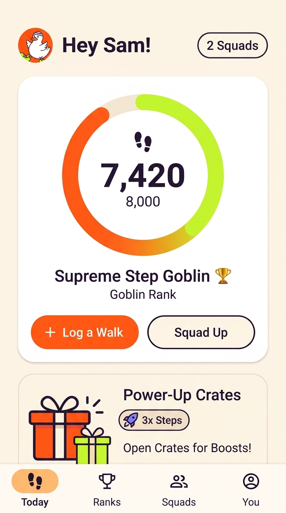
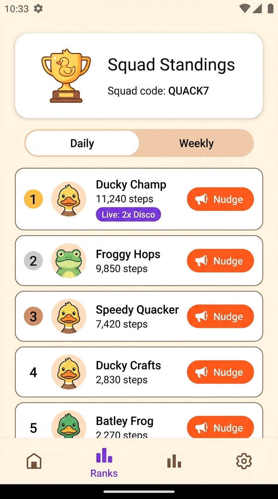
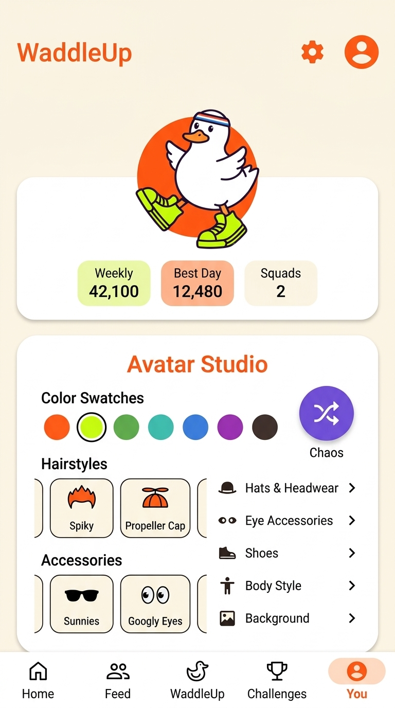

<div align="center">


# 🦆 WaddleUp

**A humorous, social Android step-tracking game built with Kotlin, Jetpack Compose, Material 3, and Firebase.**

<p>
  <a href="https://github.com/Pro-mwas1234/WaddleUp/releases/latest">
    
  </a>
  <a href="https://github.com/Pro-mwas1234/WaddleUp/releases">
    
  </a>
  <a href="https://github.com/Pro-mwas1234/WaddleUp/actions/workflows/release.yml">
    
  </a>
</p>

<p>
  
  
  <a href="https://github.com/Pro-mwas1234">
    
  </a>
  <a href="https://github.com/Pro-mwas1234/WaddleUp/graphs/contributors">
    
  </a>
</p>

<p>
  <a href="https://pro-mwas1234.github.io/WaddleUp/"><strong>🌐 Download Website</strong></a>
  &nbsp;&bull;&nbsp;
  <a href="https://github.com/Pro-mwas1234/WaddleUp/releases/latest/download/waddleup-latest.apk"><strong>📦 Direct Latest APK</strong></a>
  &nbsp;&bull;&nbsp;
  <a href="https://github.com/Pro-mwas1234/WaddleUp/releases"><strong>🏷️ All Releases</strong></a>
</p>

</div>

---

## 📸 Screenshots

| Today & Power-Up Crates | Friend Squad Leaderboards | Cartoon Avatar Studio |
| :---: | :---: | :---: |
|  |  |  |

---

## ✨ Features

- **Live Hardware Step Tracking & Manual Walks**
  - Tracks steps automatically via Android's `SensorManager` (`TYPE_STEP_COUNTER` with `TYPE_STEP_DETECTOR` fallback and `ACTIVITY_RECOGNITION` permission handling).
  - Includes a **Log a Walk** dialog with funny presets (e.g., *Fridge-to-Couch Roundtrip*, *Treadmill Strut*) and custom step entry.
  - Translates steps into **Ridiculous Units**, awards goofy stride ranks (*Certified Couch Croissant* → *Supreme Step Goblin*), displays a 7-day progress chart, and tracks daily silly quests.

- **Power-Up Steps & Mystery Crates**
  - Earn **Mystery Power-Up Crates** (1 free daily starter crate + 1 crate every 1,000 steps).
  - Activate temporary multipliers and burst boosts with a live `MM:SS` countdown HUD:
    - **Snail's Pace (`🐌`)**: `2x` steps for 5 minutes
    - **Rocket Boost (`🚀`)**: `+250` instant steps & `3x` burst for 2 minutes
    - **Disco Fever (`🪩`)**: `+150` instant steps & `2x` groove for 3 minutes
    - **Snack Magnet (`🌮`)**: `+400` instant burst steps
  - Active boosts are synced to Cloud Firestore and displayed live on squad leaderboards.

- **Animated Milestone Celebrations**
  - Prominent confetti-filled celebration overlay when crossing **Daily Step Goals**, **Weekly Targets**, or **Personal Bests** (`>= 500` steps).
  - Features your custom cartoon avatar dancing alongside backup dancers (a disco duck and hype frog), queued milestone popups, a native **Brag** share sheet, and a **Dance Party!** replay chip on the Today screen.

- **Cartoon Avatar Designer Studio**
  - Customize your avatar in the **You** (Profile) tab with 8 body colors, 7 hairstyles, 6 expressive faces, 8 wacky accessories (including animated googly eyes and a spinning propeller cap), and a **Chaos** randomizer button.
  - Avatars appear on the Today header, squad leaderboards, celebration stages, and incoming friend nudges.

- **Friend Squads, Leaderboards & Nudges**
  - Create squads with unique 6-character invite codes and share invites via Android's native share sheet (`Intent.ACTION_SEND`).
  - Switch between **Daily** and **Weekly** squad standings and send playful heckles/cheers (*Quack Attack*, *Couch Alert*, etc.) to friends.

- **In-App GitHub Updater**
  - Automatically checks GitHub Releases on launch (plus a manual **Check Updates** card in the **You** tab), downloads the signed `.apk` inside the app with live progress and SHA-256 verification, and launches Android's system package installer directly.

---

## 🛠️ Tech Stack

- **Language & UI**: Kotlin, Jetpack Compose, Material Design 3 (`Scaffold`, `NavigationBar` / adaptive `NavigationRail`), Compose Canvas animations
- **Architecture**: MVVM with `StateFlow` / `SharedFlow` (`WaddleViewModel`, `StepSensorTracker`, `WaddleRepository`)
- **Navigation**: Jetpack Navigation Compose (`androidx.navigation.compose`)
- **Backend & Auth**:
  - **Firebase Authentication** with Google Sign-In via Jetpack **Credential Manager** (`GetSignInWithGoogleOption`)
  - **Cloud Firestore** with zero-trust security rules (`firestore.rules`)
- **Testing**: JUnit 4, Robolectric, Coroutines Test, and Node.js Firestore Rules unit tests (`firestore.test.js`)

---

## 📁 Project Structure

```text
app/src/main/java/com/example/
├── MainActivity.kt                  # Edge-to-edge activity entry point
├── auth/
│   └── GoogleAuthHelper.kt          # Credential Manager Google Sign-In & Sign-Out
├── data/
│   ├── AppUpdateChecker.kt          # Checks GitHub Releases & opens direct APK updates
│   ├── FirestoreErrorHandler.kt     # Structured Firestore error logging
│   ├── StepSensorTracker.kt         # SensorManager pedometer, crates & power-up logic
│   └── WaddleRepository.kt          # Firestore CRUD, squad invites, leaderboard & nudges
├── model/
│   ├── AvatarParts.kt               # Avatar parts, PowerUpType, CelebrationMilestone
│   ├── WaddleHumor.kt               # Stride ranks, weird units, quests & funny copy
│   └── WaddleModels.kt              # UserProfile, Squad, SquadMember, FriendNudge
└── ui/
    ├── WaddleApp.kt                 # Auth gate, adaptive scaffold, NavHost & updater
    ├── WaddleViewModel.kt           # State management, cloud sync, timers & milestones
    ├── components/
    │   ├── AppUpdateDialog.kt       # In-app GitHub update prompt & release notes dialog
    │   ├── AvatarStudioCard.kt      # Interactive cartoon avatar customizer
    │   ├── CartoonAvatar.kt         # Custom Canvas cartoon avatar renderer
    │   ├── CelebrationOverlay.kt    # Confetti & dancing character milestone dialog
    │   ├── PowerUpPanel.kt          # Active power-up HUD, crate opener & stash
    │   └── WaddleComponents.kt      # Step ring, 7-day chart, nudge sheet & share helper
    ├── screens/
    │   ├── AuthScreen.kt            # Google Sign-In onboarding screen
    │   ├── TodayScreen.kt           # Daily dashboard, power-ups, quests & log walk
    │   ├── LeaderboardScreen.kt     # Daily/Weekly squad standings & live boost badges
    │   ├── SquadsScreen.kt          # Squad creation/joining & incoming nudges inbox
    │   └── ProfileScreen.kt         # Avatar studio, updates card, bio/excuse & daily goal
    └── theme/                       # Material 3 color scheme & bundled typography
```

---

## 🔐 Permissions

Declared in `app/src/main/AndroidManifest.xml`:
- `android.permission.INTERNET` — Cloud Firestore sync and Google Sign-In.
- `android.permission.ACTIVITY_RECOGNITION` — Runtime permission requested on Android 10+ (API 29+) for hardware step counting.

Hardware features (`stepcounter`, `stepdetector`) are marked `android:required="false"` so devices without a hardware pedometer can still log walks manually.

---

## 🗄️ Firestore Data Model

- `users/{userId}` — User profile, daily/weekly step totals, personal best (`bestDailySteps`), `avatarCode`, active power-up state, and 14-day history map.
- `users/{userId}/nudges/{nudgeId}` — Incoming heckles/cheers from squadmates (`senderAvatarCode`, `nudgeType`, `message`, `acknowledged`).
- `squads/{squadId}` — Squad metadata (`name`, `motto`, `inviteCode`, `memberIds`).
- `squads/{squadId}/members/{userId}` — Denormalized leaderboard member stats, avatar, and live power-up badge.
- `squad_invites/{inviteCode}` — Lookup table mapping 6-character codes to squad IDs.

---

## 🚀 Building & Testing

### Compile & Run Android Unit Tests
```bash
# Compile debug APK
gradle :app:compileDebugKotlin

# Run local JVM & Robolectric unit tests
gradle :app:testDebugUnitTest
```

### Run Firestore Security Rules Tests
With the Firebase Firestore Emulator running on port `8085`:
```bash
FIRESTORE_EMULATOR_HOST="127.0.0.1:8085" node --test firestore.test.js
```

---

## 📦 GitHub Actions Release Workflow

The workflow in `.github/workflows/release.yml` runs unit tests, builds both a signed **Release APK** (`waddleup-<tag>.apk` + `waddleup-latest.apk`) and **Android App Bundle** (`waddleup-<tag>.aab`), uploads them as workflow artifacts, publishes a **GitHub Release**, and deploys the auto-updating download website (`docs/`) to **GitHub Pages**.

### Triggering a Release
- **Auto-release on changes**: Pushing commits to `main` or `master` automatically runs tests, builds the APK & AAB, publishes a GitHub Release (`v1.0.1` initially, then auto-incrementing patch versions `v1.0.2`, `v1.0.3`, ...), and updates the download website.
- **Tag push**: Push any `v*` tag for an explicit version:
  ```bash
  git tag v1.0.0
  git push origin v1.0.0
  ```
- **Manual dispatch**: Run **Release Android App** from the **Actions** tab in GitHub (optionally specifying a `release_tag` and toggling `publish_release`).

### Direct Download Website (GitHub Pages)
The static download page lives in `docs/` (`index.html`, `styles.css`, `app.js`, `releases.json`) and automatically stays synced with every release in two ways:
1. After each release publishes, the `deploy-website` job writes the latest release metadata & APK SHA-256 into `docs/releases.json` and deploys to GitHub Pages.
2. On page load, `docs/app.js` also queries GitHub's live Releases API and falls back to the permanent latest APK link (`https://github.com/<owner>/<repo>/releases/latest/download/waddleup-latest.apk`).

To enable the live site once on GitHub:
1. Open **Settings → Pages** in your GitHub repository.
2. Under **Build and deployment → Source**, choose **GitHub Actions** (or **Deploy from a branch** → `main` / `/docs`).

### Repository Secrets (for Production Signing)
Configure these in **Settings → Secrets and variables → Actions** (matching the `release` signing config in `app/build.gradle.kts` with `keyAlias = "upload"`):
- `RELEASE_KEYSTORE_BASE64` — Base64-encoded upload keystore (`.jks`)
- `STORE_PASSWORD` — Keystore password
- `KEY_PASSWORD` — Upload key password
- `GOOGLE_SERVICES_JSON_BASE64` *(optional)* — Base64-encoded `app/google-services.json` if excluded from Git
- `APP_ENV_FILE` *(optional)* — Contents for `.env` if additional Secrets Gradle Plugin keys are needed

> If `RELEASE_KEYSTORE_BASE64` is omitted, CI automatically signs with the repository's persistent `debug.keystore.base64` key so APK updates install cleanly in-place without uninstalling and match the SHA-1 already registered in Firebase for Google Sign-In. For Google Play Store releases using a custom keystore, also register that keystore's (and Play App Signing's) SHA-1 in Firebase Console.

